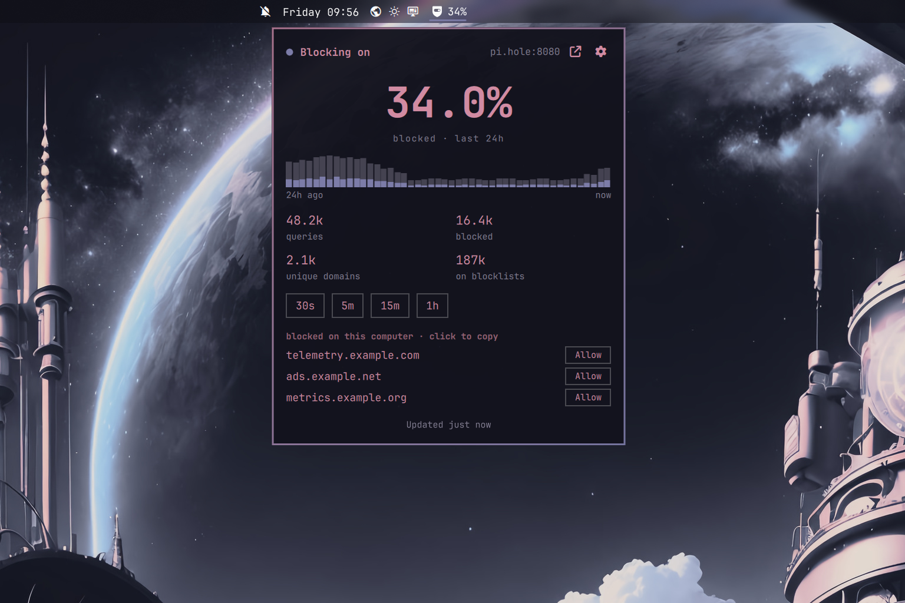

<p align="center">
  
</p>

# OmaPihole

<p align="center">
  
</p>

Pi-hole presence in the Omarchy bar: **state, pause, glance.**

Not a dashboard. A shield in the bar, a pause in the panel.

- See that blocking is on — or that you paused it for a broken site and forgot.
- Pause for 30 seconds, 5 minutes, 15 minutes, or an hour without leaving the current window, or from a keybinding.
- See what the Pi-hole just blocked **for this computer**. Click a domain to copy it, or allow it after a confirming second click.
- Glance at the last 24 hours’ block rate, and notice when the Pi-hole has an update or warnings waiting.

One Pi-hole. The app password lives in a mode-600 file, never in `shell.json`.

## Requirements

- **Omarchy 4.5 or newer.** On Omarchy 4.0, stay on [`v0.2.0`](#omarchy-40).
- **Pi-hole v6.** Tested with Pi-hole Core 6.6, Web 6.6.1 and FTL 6.9.
- `python3`, `curl`, and `wl-copy` (for copying domains), all part of a standard Omarchy install.

## Install

OmaPihole is a third-party plugin and runs **unsandboxed** inside `omarchy-shell`, with your user permissions. Review the repository before enabling it.

```sh
omarchy plugin add https://github.com/BVisagie/omarchy-omapihole.git --enable
```

Without `--enable`, Omarchy clones the repo, validates the manifest, and leaves the widget off so you can read the checkout at `~/.config/omarchy/plugins/bvisagie.omapihole/` first. Enable it later with `omarchy plugin enable bvisagie.omapihole`. The widget lands in the right bar section.

## Setup

1. On the Pi-hole: **Settings → Web interface / API → app password**.
2. Pi-hole supports one application password. If another integration already uses it, reuse that password instead of needlessly rotating it.
3. Write the password to `~/.config/omapihole/password` (outside `~/.config/omarchy/`, which is what people commit to dotfiles repos) and `chmod 600` that file. OmaPihole does not support an interactive TOTP prompt; use the Pi-hole application password when 2FA is enabled.
4. Left-click the muted shield, fill in the API URL, and **Test connection** (or press Enter). A successful test saves; **Save** stores the settings without testing. If the test fails, its message names the cause, such as `Connection refused`.

### The API URL needs the port

The API URL is where OmaPihole sends every request, so it must include the port that serves Pi-hole's web interface and API, unless that is the default for the scheme (80 for `http`, 443 for `https`). Use the address your dashboard opens at, without `/admin/`:

```text
Dashboard: http://pi.hole:8080/admin/
API URL:   http://pi.hole:8080
```

For Pi-hole in Docker, use the host's published port: with a `8080:80` mapping, that is `:8080`.

**Dashboard URL** only sets where the dashboard opens (the ↗ button, `o`, and right-click unless it is set to pause). It is not used for API requests and does not supply a missing port; leave it empty when the dashboard is at the API URL plus `/admin/`.

**Prefer HTTPS.** `http://` sends the password and session ID without encryption, so use it only on a trusted LAN. For a Pi-hole with its own certificate, point **CA certificate file** (`caFile`) at the PEM file that signed it. **Allow insecure TLS** only skips certificate verification for `https://`: it has no effect on `http://` and cannot fix a wrong address or port.

To change settings later, open the panel and click the gear (or press `s`). Passwordless Pi-holes work with an empty or missing password file.

## Using it

| | |
|---|---|
| Left click | Open / close the panel |
| Middle click | Refresh now |
| Right click | Open the dashboard; with `rightClick` set to `pause`, pause for 5 minutes, or resume |
| `1` `2` `3` `4` | Pause 30s / 5m / 15m / 1h |
| `e` | Resume / enable while paused or off |
| `r` | Refresh |
| `o` | Open dashboard |
| `s` | Settings |
| Esc | Leave a text field, close settings, then close the panel |

While blocking is paused, the bar shows a live countdown instead of the metric, and returns to it at 0 without sitting on `0:00`. Away from home (a private-IP Pi-hole that is unreachable), the bar shows just the muted mark and the panel says how old the last-known numbers are.

The blocked list shows **this computer's** recent blocks: the Pi-hole reports the address it sees this computer at, and the panel asks for that client's blocked queries. Behind a reverse proxy or NAT the Pi-hole sees the proxy instead; then the list falls back to the whole network, and its heading says so. Click a domain to copy it. **Allow** turns into **Confirm**; a second click within four seconds adds an exact allowlist entry with the comment “Allowed from OmaPihole”. Remove it from the Pi-hole’s Domains page if you change your mind.

When the Pi-hole is behind its latest release, a line names what to update; click it for the dashboard. A count of Pi-hole warnings opens its messages page.

### Keybindings

The widget answers IPC, so a key can pause without opening the panel. For example, in `~/.config/hypr/bindings.lua`:

```lua
o.bind("SUPER + ALT + P", "Pause Pi-hole for 5 minutes", "omarchy-shell bvisagie.omapihole pause 300")
o.bind("SUPER + ALT + SHIFT + P", "Resume Pi-hole blocking", "omarchy-shell bvisagie.omapihole resume")
```

Other methods: `toggle`, `open`, `close`, `refresh`. `pause` takes 1–86400 seconds.

## Settings

Stored on the widget’s `shell.json` layout entry. Booleans and integers need `--json` or they land as strings (the plugin still coerces hand-edited strings):

```sh
omarchy bar set bvisagie.omapihole url 'https://pi.hole'
omarchy bar set bvisagie.omapihole caFile '~/.config/omapihole/pihole-ca.crt'
omarchy bar set bvisagie.omapihole refreshSeconds 30 --json
```

| Key | Default | Meaning |
|---|---|---|
| `url` | `""` | API URL, with the port unless it is 80 for `http` or 443 for `https`: e.g. `http://pi.hole:8080`. A trailing `/admin` or `/api` is dropped; any other path is kept for a reverse proxy. Empty means unconfigured. |
| `dashboardUrl` | `""` | Where the dashboard opens, when the web interface is not at `url` + `/admin/`. Not used for API requests. |
| `passwordFile` | `~/.config/omapihole/password` | App password file. Must be mode 600 if it exists. |
| `allowInsecure` | `false` | Skip certificate verification for `https://`. No effect on `http://`. Prefer `caFile`. |
| `caFile` | `""` | PEM file that signed the Pi-hole's HTTPS certificate, passed to curl as `--cacert`. Empty uses the system trust store. |
| `refreshSeconds` | `20` | Bar poll interval, 10–120 seconds. `0` turns timed polling off; see [Network and privacy](#network-and-privacy). |
| `barMetric` | `percent` | Bar label while blocking is on: `percent`, `rate` (queries per minute), or `queries` (24h total). Pause and off override it. |
| `rightClick` | `dashboard` | `dashboard` opens the dashboard; `pause` pauses for 5 minutes while blocking is on and resumes while it is paused or off. |

## Network and privacy

OmaPihole talks only to the Pi-hole you configure, through `curl`, limited to HTTP and HTTPS:

- **Every `refreshSeconds`** (20 by default): blocking state and the 24-hour summary. Set `refreshSeconds` to `0` to stop timed polling; the widget then asks only at start-up, when the panel opens, when you refresh, pause or allow, and once when a pause you set runs out, to confirm blocking is back.
- **While the panel is open**, once a minute: the 24-hour history, this computer's address as the Pi-hole sees it and its recent blocked queries (or the network's, as a fallback), the Pi-hole's version information, and its warning count. The Pi-hole itself checks GitHub for new versions; OmaPihole never contacts anything else.
- **On a 429** (rate limit), timed polls back off for 60, 120, then 300 seconds.

What it keeps on disk: the Pi-hole session ID and the host it belongs to, in `~/.local/state/omapihole/session` (mode 600). A session saved for one Pi-hole is never sent to another, and **Test connection** uses a throwaway session that it logs out of afterwards. Only the helper reads the password, and it sends it only to the Pi-hole, to log in. The password and the session ID reach `curl` on its standard input and a pipe, never on its command line, where other local users could read them.

## Update

```sh
omarchy plugin update bvisagie.omapihole
omarchy restart shell
```

The shell hot-reloads the widget after an update, but keeps the QML it compiled before, so the old code can keep running (or briefly show "Not configured"). `omarchy restart shell` loads the new version.

### Omarchy 4.0

This version needs Omarchy 4.5. On Omarchy 4.0, keep the last release that supports it:

```sh
git -C ~/.config/omarchy/plugins/bvisagie.omapihole checkout v0.2.0
omarchy restart shell
```

Don't run `omarchy plugin update` for this plugin while you stay on 4.0: it would move the checkout forward to the current version again. After upgrading Omarchy, return with `git -C ~/.config/omarchy/plugins/bvisagie.omapihole checkout main`, then update.

## Troubleshooting

Start with the address, the port and the network; look at the password only when the Pi-hole rejects it. **Test connection** in settings names the cause.

- **Away from home.** The API URL is a private IP address (`10.x`, `172.16–31.x`, `192.168.x`) and the Pi-hole did not answer: a timeout, a refused connection, or a TLS failure. It does not prove you are away. Check that the URL has the right port (see [The API URL needs the port](#the-api-url-needs-the-port)), that the Pi-hole is running, and that this computer can reach it, for example over a VPN.
- **Offline.** The same, for a URL that uses a hostname such as `pi.hole`.
- **Failed.** Something answered, but not as Pi-hole's API: often another web server on that port. Check the port.
- **`auth` in the bar, Auth failed in the panel.** The Pi-hole rejected the login. The password file is missing, not mode 600, or holds the web password of a Pi-hole with 2FA. Use the app password; see [Setup](#setup).
- **`Pi-hole is rate-limiting`.** Too many logins, or no free API sessions (`webserver.api.max_sessions`). OmaPihole backs off on its own; a manual refresh retries at once.
- **TLS verification failed.** Set `caFile` to the certificate authority that signed the Pi-hole's certificate. Pi-hole renews its own self-signed certificate with a new CA, so after a renewal, export it again.
- **The blocked list says “on the network”.** The Pi-hole sees this computer through a proxy or NAT, so it cannot tell this computer's queries apart.

## Uninstall

```sh
omarchy plugin remove bvisagie.omapihole
rm -rf ~/.local/state/omapihole
```

`plugin remove` deletes the plugin checkout. The second line removes the saved session. Neither touches `~/.config/omapihole/password`.

## Development

```sh
python3 -m unittest discover -s tests -v   # helper
node --test tests/test_*.js                # model, QML rules, catalog, manifest
uvx ruff check                             # lint
```

To check the plugin the way Omarchy will, validate a clean copy of a commit:

```sh
mkdir -p /tmp/omapihole && git archive HEAD | tar -x -C /tmp/omapihole && omarchy plugin validate /tmp/omapihole
```

The plugin's strings are in `i18n/en.json`, read through Omarchy's `Commons.Translations`. In code, write `tr("key", "English")`, then run `node tests/tools/build_catalog.js` to update the catalog. To translate, add `i18n/<code>.json` with any subset of the keys, using a code from Omarchy's `default/i18n/locales.json`.

See [CHANGELOG.md](CHANGELOG.md) for what changed, and [SECURITY.md](SECURITY.md) to report a vulnerability.

## License

[MIT](LICENSE)
